# Anchor Code

**English** · [中文](README.zh-CN.md)

**The human-in-the-loop reviewer for agentic coding.**
**Agent it. Review it. Feed it back.**

Anchor Code puts the codebase, technical documents, Git history, diffs, review comments, and your agent CLIs in one desktop app. Agents keep working in their native terminal while you read the context, discuss exact lines, send structured feedback, and decide when the result is ready.

**[Download the latest release →](https://github.com/Roboaholic/anchor-code/releases/latest)** (Windows · macOS · Linux)

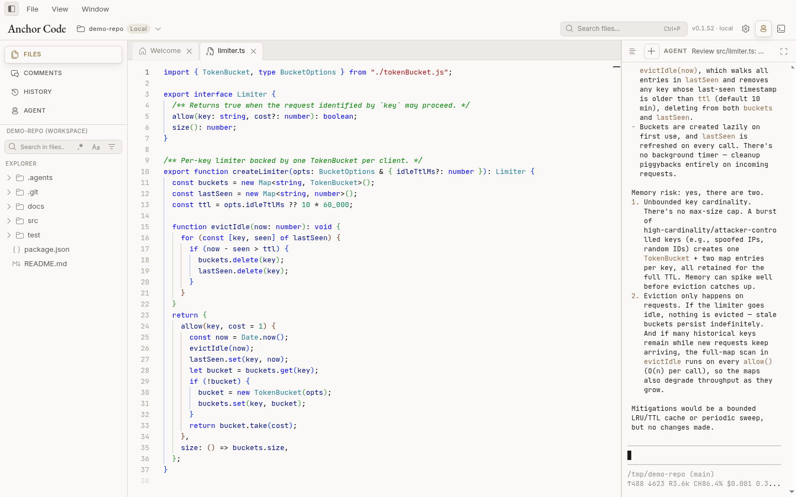

## Features

The loop is the same every time: the agent writes, you read the exact lines, you mark what still needs work, and **Feedback** sends that session back. Screenshots below show the layout. Clips show the motion.

### Comments anchored to exact lines

Select code or rendered Markdown and leave a comment in an inline bubble anchored to the selection. Each thread is a question (`discussing`), a change request (`need_modify`), or resolved (`closed`).

A review session keeps those threads next to the file. The agent replies in the same thread and can update the status. It does not start a new chat somewhere else.

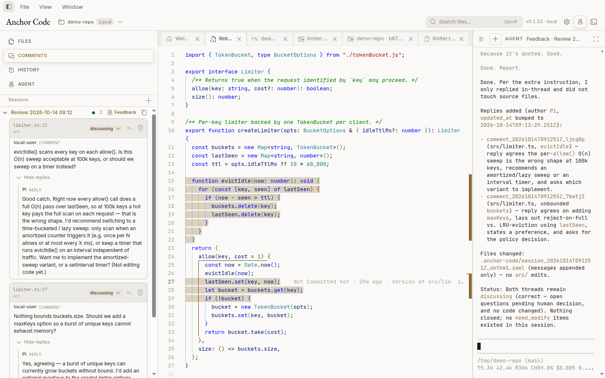

Writing a comment stays on the selection. Pick the status while you type, then add it.

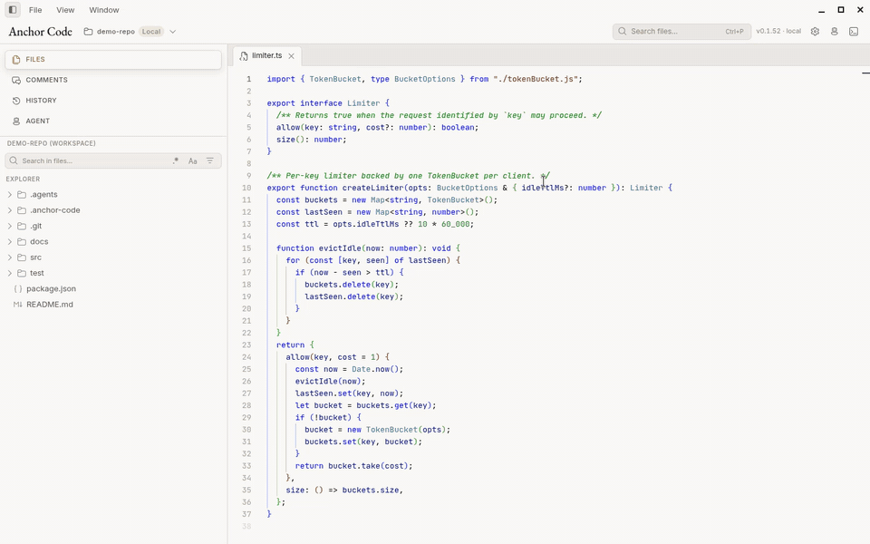

**Feedback** hands the whole session to the agent. The reply lands back in the thread, with the files it touched and which threads are still open.

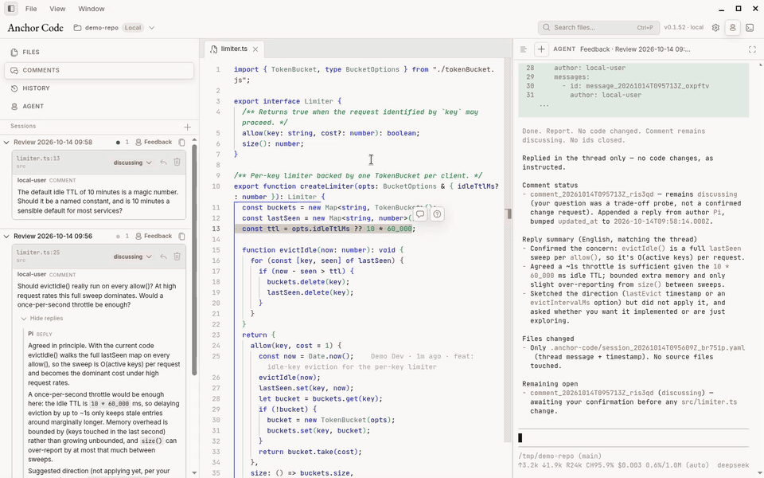

### Worktree diffs

Open any changed file from **History → Changes** to see the uncommitted diff side by side or inline, with inline blame for context.

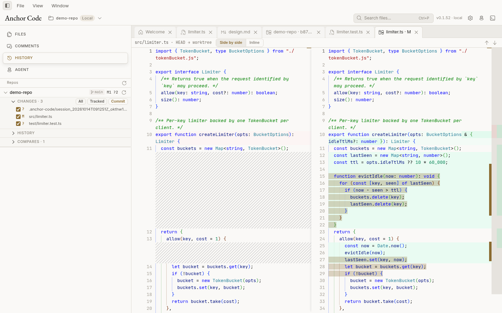

### Git history built for inspection

Pick any two commits, or a commit and the current worktree, and **Compare** opens the complete changed-file set in one diff workspace. Comments made in a diff keep their branch, base, head, file, and line-range context.

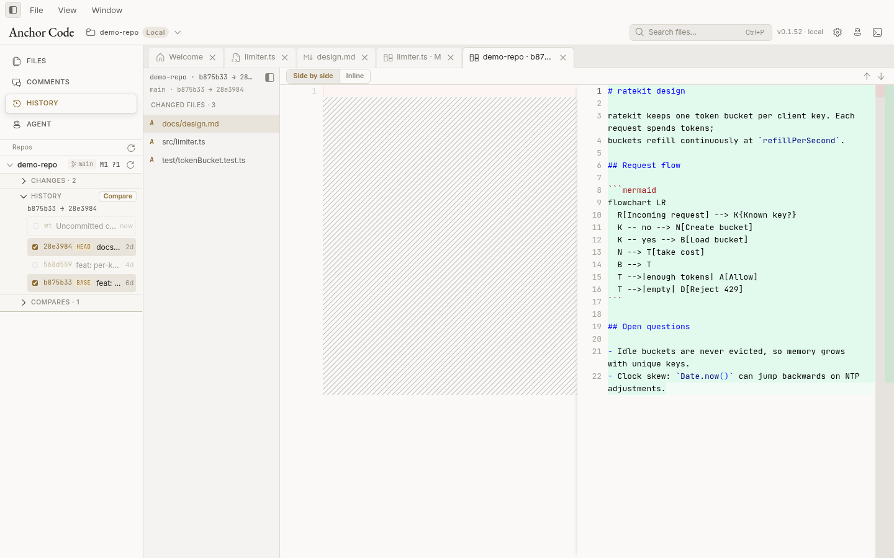

### Agent CLI sessions

Agents stay in their own terminal. Anchor Code hosts that session in the side panel or the full-width **Agent** workbench, so the review and the CLI share one window.

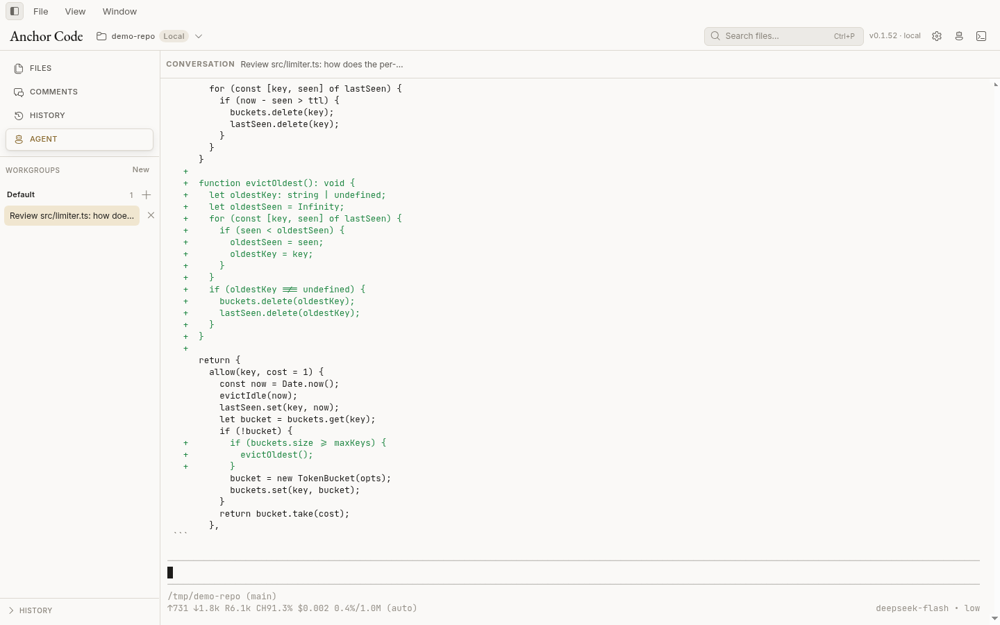

Start a session from the picker — Claude Code, Codex, Gemini CLI, Grok, OMP, Pi, and others — or resume one the CLI already knows. Model and reasoning effort show up when the CLI supports them.

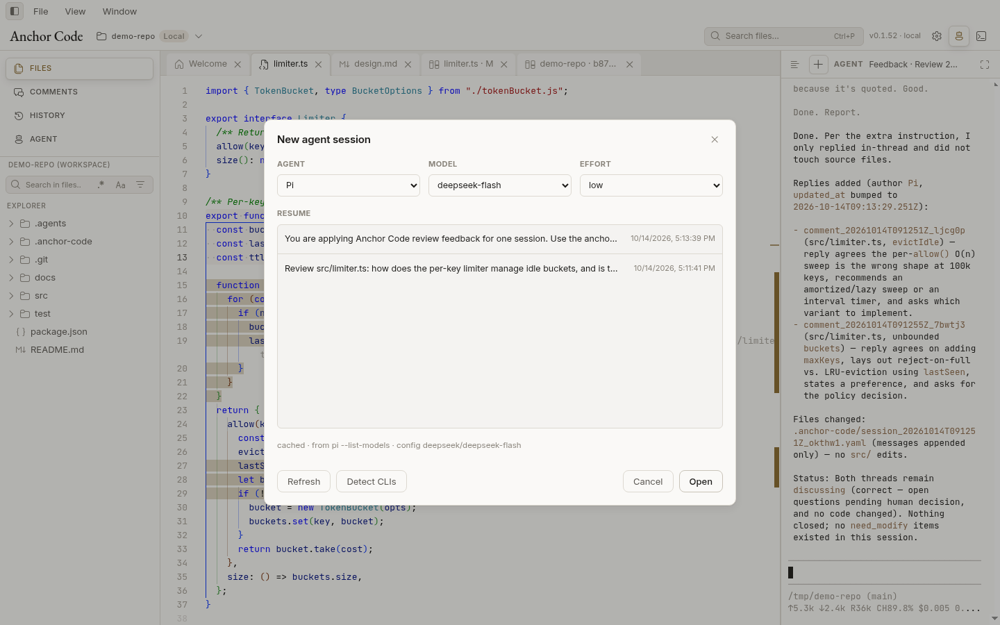

Several sessions can run at once. The list in the panel is how you switch. Each one keeps its own terminal.

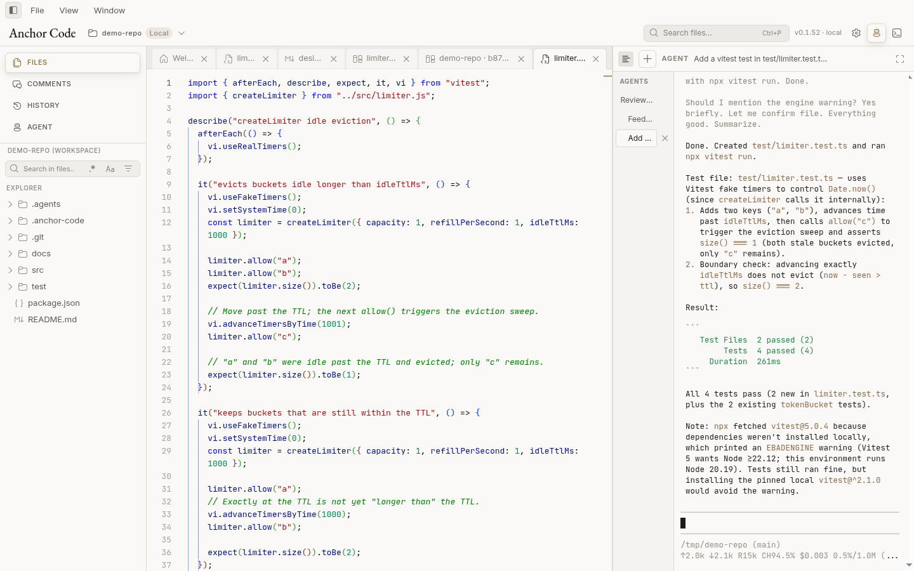

A session is just the CLI. Below, a new Pi session edits the file and runs the tests without leaving the workbench.

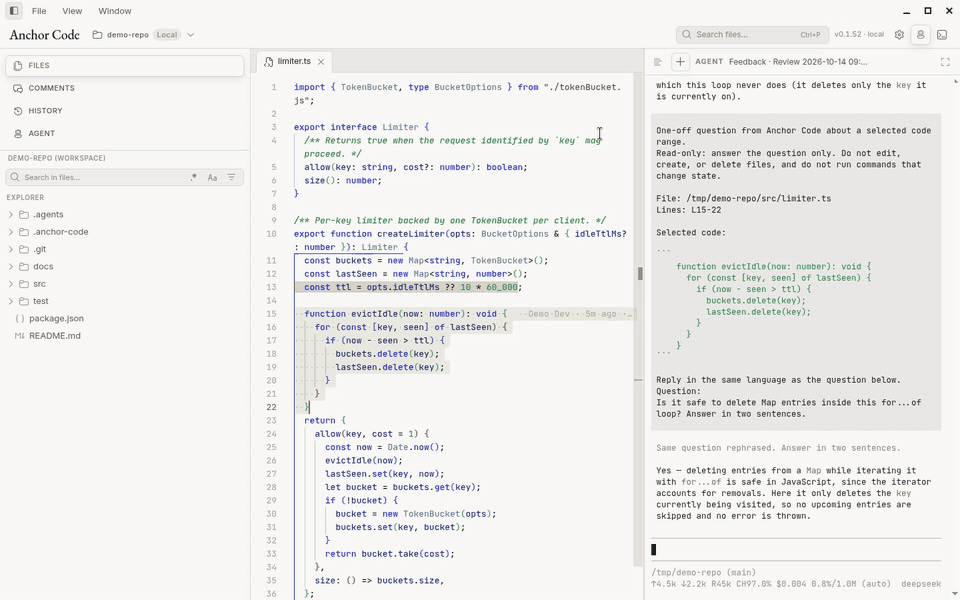

### Ask about a selection

Select lines and press **?** when you want an answer, not a review thread. The question sits in a small popover on the selection. Send it to an idle session, or start a new one. **Read-only** is on by default, so a new agent starts in plan / read-only mode. `Ctrl+Enter` sends.

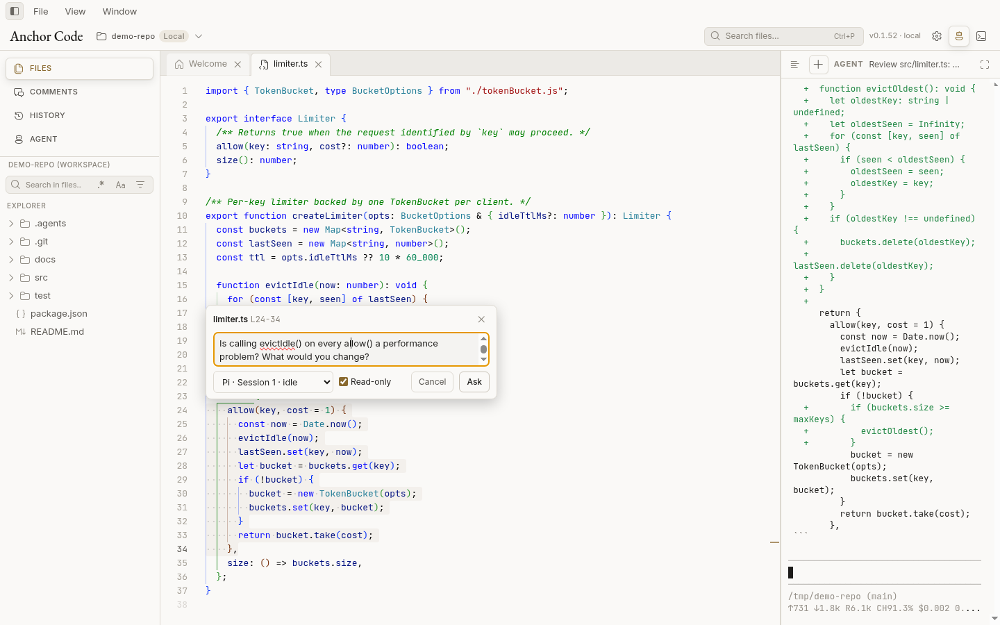

The answer comes back in the agent panel, still tied to the lines you selected.

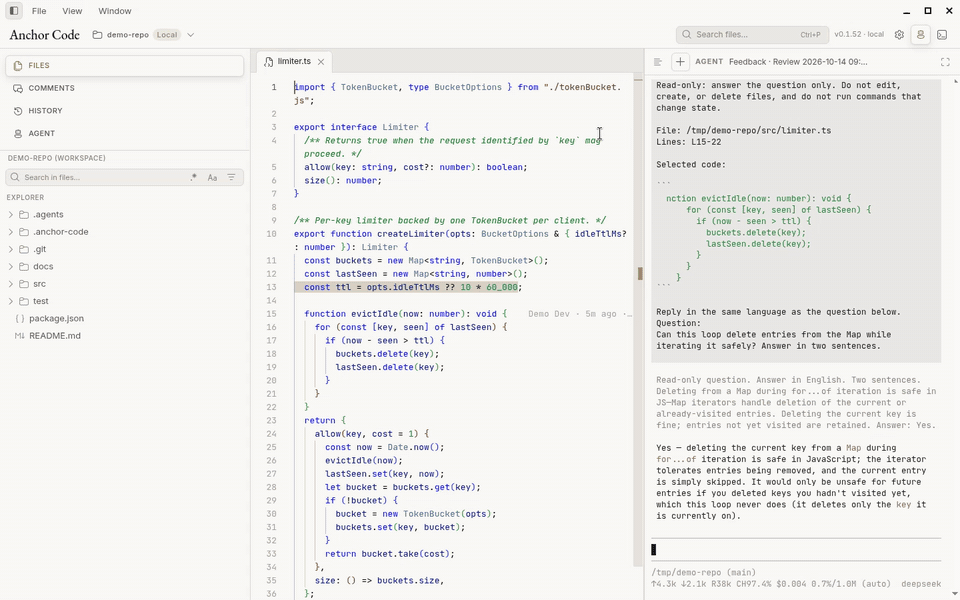

### Markdown and Mermaid

Technical documents render in place, including Mermaid diagrams. Rendered text can be commented on the same way as code.

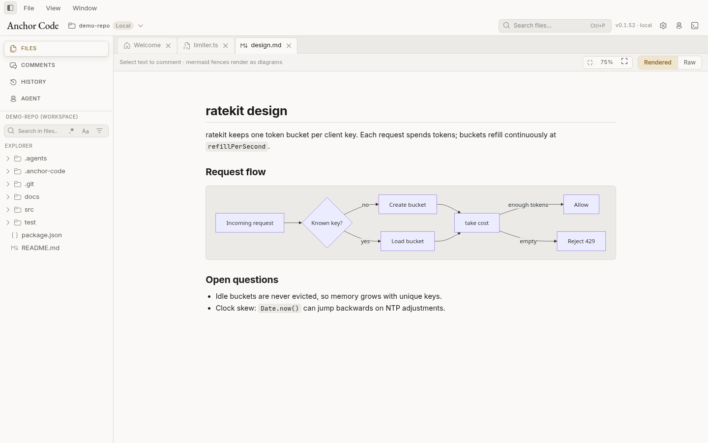

### Search and quick open

Content search streams matches as ripgrep finds them. Search and quick open both honour `.anchorignore` and the per-workspace exclude filters.

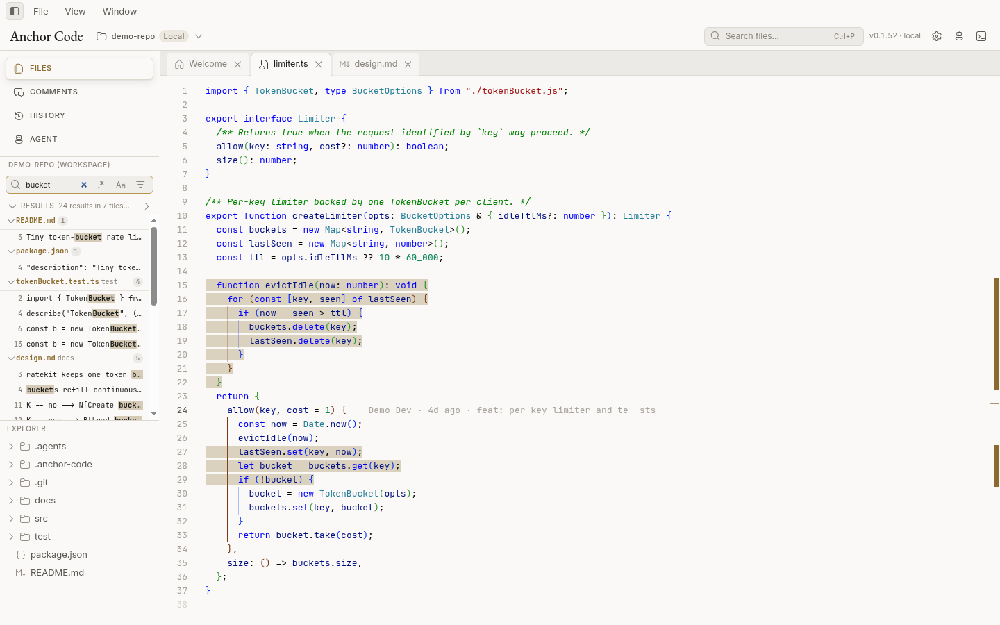

`Ctrl+P` is the file picker: fuzzy-match a path, then open it.

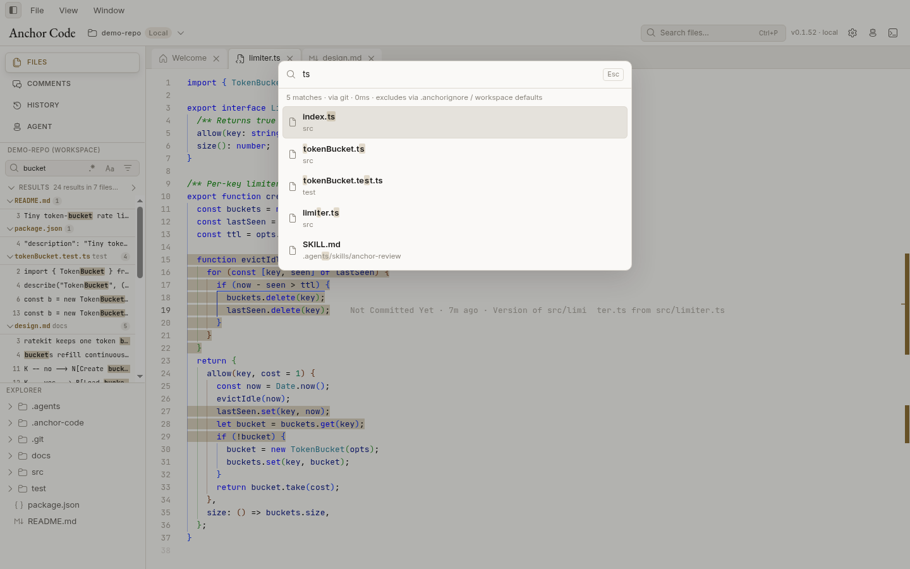

## Workspaces

| Workspace | Where files, Git, and agents run | Notes |
|---|---|---|
| **Local** | This computer | File tree updates via native file watching. |
| **WSL** (Windows) | Inside a WSL distro | Uses a helper process inside WSL for fast search and Git. |
| **SSH** | A remote host over SSH | Requires `git` on the remote host. |

Anchor Code reopens the last active workspace on launch (toggle in **Settings → Appearance → Startup**) and falls back to the Welcome page if it is unavailable.

**Supported agent CLIs:** Claude Code, Codex, Gemini CLI, Grok, OMP, Pi, Aider, Goose, Cursor Agent, and custom profiles.

## Install

Download from [Releases](https://github.com/Roboaholic/anchor-code/releases/latest):

| Platform | File |
|---|---|
| Windows (x64) | `Anchor.Code-<version>-win-x64.exe` (installer) or `Anchor.Code-<version>-win-x64-portable.exe` |
| macOS (Apple silicon) | `Anchor.Code-<version>-mac-arm64.zip` |
| Linux (x64) | `Anchor.Code-<version>-linux-x86_64.AppImage` or `Anchor.Code-<version>-linux-amd64.deb` |

Requirements: `git` on the host you open (local, WSL, or SSH), plus whichever agent CLIs you want to use on that host. Updates are checked against GitHub Releases (**Settings → Updates**).

## Quick start

1. Install and launch Anchor Code, then **Open Workspace** (Local, WSL, or SSH).
2. Start an agent with **New agent session**, or open a repository that already has changes.
3. Read the code and docs; use **History** to inspect the worktree or compare commits.
4. Select lines to comment, and mark actionable ones as `need_modify`.
5. Press **Feedback** to hand the session to the agent, then review the next diff and close resolved threads.

Install the **Anchor Review** skill from **Settings → Agent skill** (or accept the workspace prompt). It teaches compatible agents to read Anchor Code sessions, apply `need_modify` comments, reply in threads, and update status.

## Build from source

Requires Node.js 22 and Git.

```bash
git clone https://github.com/Roboaholic/anchor-code.git
cd anchor-code
npm ci            # also prepares node-pty and the bundled ripgrep
npm run dev       # run the app with hot reload

npm run typecheck && npm run lint && npm test

npm run pack:linux   # or pack:win / pack:mac — installers land in release/
```

## License

[Apache License 2.0](LICENSE)
