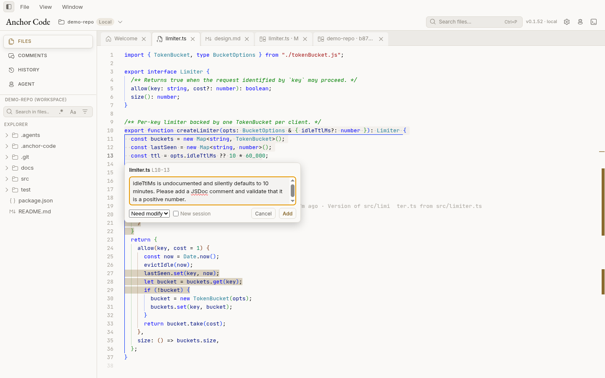

# Anchor Code

[English](README.md) · **中文**

**面向 Agent 编程的人在回路（human-in-the-loop）审阅工具。**
**Agent it. Review it. Feed it back.**

Anchor Code 把代码、技术文档、Git 历史、Diff、审阅评论和你在用的 Agent CLI 放进同一个桌面应用。Agent 继续在原生终端里工作，你在这里阅读上下文、针对具体行讨论、发送结构化反馈，并决定结果是否可以交付。

**[下载最新版本 →](https://github.com/Roboaholic/anchor-code/releases/latest)**（Windows · macOS · Linux）


## 功能

### 锚定到具体行的评论

选中代码或渲染后的 Markdown，即可在锚定于选区的行内气泡中写评论，并在写的同时选择状态。审阅会话把每条评论标记为问题（`discussing`）、修改请求（`need_modify`）或已解决（`closed`）；点击 **Feedback** 把整个会话交给 Agent，Agent 可以在原线程回复并更新状态。




### 工作区 Diff

在 **History → Changes** 里打开任意改动文件，即可并排或行内查看未提交的 Diff，并附带行内 blame。


### 为审阅设计的 Git 历史

任选两个提交，或一个提交与当前工作区，点击 **Compare** 就能在一个 Diff 工作台里看到完整的改动文件列表。在 Diff 中创建的评论会保留分支、base、head、文件和行范围上下文。


### Agent CLI 会话

在项目里以原生终端 / TUI 运行 Claude Code、Codex、Gemini CLI 等 Agent CLI，可放在侧栏，也可用全宽的 **Agent** 工作台。CLI 支持时，可选择模型、推理强度并恢复会话。


在 Agent 选择器中新建会话（Claude Code、Codex、Grok、OMP、Pi 等），选择模型与推理强度，或从列表中恢复之前的会话。多个会话可以同时运行，通过会话列表切换。


### 针对选区提问（Ask）

选中几行后点 **?**，在锚定于选区旁的小气泡里向 Agent 提问。可以发给空闲会话，也可以新建会话；**Read-only**（默认勾选）会让新建的 Agent 以 plan / 只读模式启动。按 `Ctrl+Enter` 发送。


### Markdown 与 Mermaid

技术文档原地渲染，包括 Mermaid 图，渲染后的文字也能像代码一样评论。


### 搜索与快速打开

内容搜索在 ripgrep 找到结果时流式显示；`Ctrl+P` 对文件路径做模糊匹配。两者都遵守 `.anchorignore` 和每个工作区的排除规则。


## 工作区

| 工作区 | 文件、Git 与 Agent 运行位置 | 说明 |
|---|---|---|
| **Local** | 本机 | 文件树通过系统文件监听自动刷新。 |
| **WSL**（Windows） | WSL 发行版内 | 在 WSL 内使用辅助进程加速搜索和 Git。 |
| **SSH** | 通过 SSH 连接的远程主机 | 远程主机需要安装 `git`。 |

Anchor Code 启动时会重新打开上次的工作区（可在 **Settings → Appearance → Startup** 关闭）；如果它不可用，就停留在欢迎页。

**支持的 Agent CLI：** Claude Code、Codex、Gemini CLI、Grok、OMP、Pi、Aider、Goose、Cursor Agent，以及自定义配置。

## 安装

从 [Releases](https://github.com/Roboaholic/anchor-code/releases/latest) 下载：

| 平台 | 文件 |
|---|---|
| Windows（x64） | `Anchor.Code-<version>-win-x64.exe`（安装版）或 `Anchor.Code-<version>-win-x64-portable.exe`（便携版） |
| macOS（Apple 芯片） | `Anchor.Code-<version>-mac-arm64.zip` |
| Linux（x64） | `Anchor.Code-<version>-linux-x86_64.AppImage` 或 `Anchor.Code-<version>-linux-amd64.deb` |

要求：所打开的主机（本机、WSL 或 SSH）上装有 `git`，以及你想使用的 Agent CLI。更新通过 GitHub Releases 检查（**Settings → Updates**）。

## 快速上手

1. 安装并启动 Anchor Code，点击 **Open Workspace**（Local、WSL 或 SSH）。
2. 用 **New agent session** 启动 Agent，或打开一个已有改动的仓库。
3. 阅读代码和文档；用 **History** 查看工作区改动或对比提交。
4. 选中代码行添加评论，需要修改的标为 `need_modify`。
5. 点击 **Feedback** 把会话交给 Agent，然后审阅下一版 Diff，关闭已解决的线程。

在 **Settings → Agent skill** 安装 **Anchor Review** 技能（或接受工作区里的提示）。它教会兼容的 Agent 读取 Anchor Code 会话、处理 `need_modify` 评论、在线程中回复并更新状态。

## 从源码构建

需要 Node.js 22 和 Git。

```bash
git clone https://github.com/Roboaholic/anchor-code.git
cd anchor-code
npm ci            # 同时准备 node-pty 和内置的 ripgrep
npm run dev       # 以热更新方式运行

npm run typecheck && npm run lint && npm test

npm run pack:linux   # 或 pack:win / pack:mac，安装包输出到 release/
```

## 许可证

[Apache License 2.0](LICENSE)
